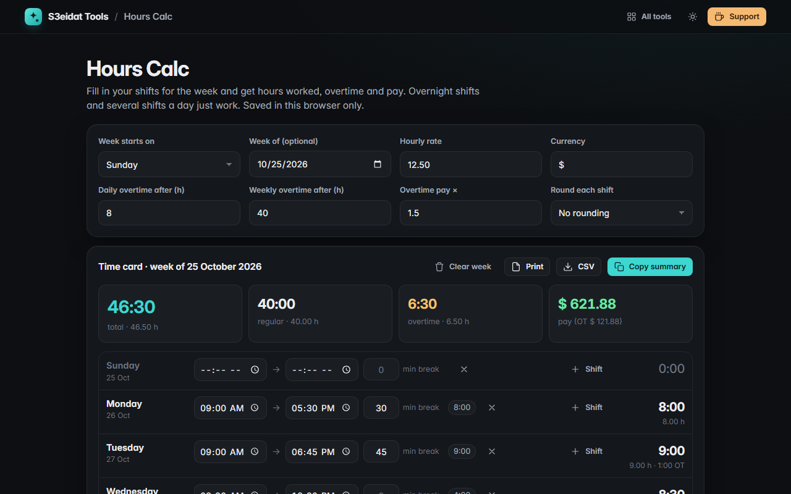

# Hours Calc

> A weekly time card and hours-worked calculator. Free, private, and it runs entirely in your browser.

### ▶ [Open Hours Calc](https://s3eidat.github.io/hours-calc/)



## Features

- **Week grid** starting Saturday, Sunday or Monday, with optional dates ("week of")
- **Several shifts a day** (split shifts), each with its own **break in minutes**
- **Overnight shifts**: an end time at or before the start time rolls into the next day (22:00 → 06:00 with a 30 min break = 7:30)
- Totals per day and per week in **h:mm and decimal hours**
- **Overtime** after a daily threshold, a weekly threshold, or both (daily first, then weekly on the remaining regular hours), paid at your **multiplier** (×1.5 by default)
- **Hourly rate and pay** in any currency symbol
- Optional rounding of each shift to the nearest 5, 6 or 15 minutes
- **CSV export**, clean **print** layout, copy a plain-text summary
- Saved automatically in this browser (localStorage); clear the week with undo

## Privacy

Your hours never leave your device. There is no server, no account, no analytics.
The page ships with a strict Content-Security-Policy (`connect-src 'self'`), so the browser
itself blocks any attempt to send data anywhere.

## Run it yourself

It's plain HTML, CSS and JavaScript with no build step:

```bash
git clone https://github.com/s3eidat/hours-calc
cd hours-calc
python -m http.server 8000
```

Then open http://localhost:8000.

## Support

If this saved you time, **[buy me a coffee ☕](https://s3eidat.github.io/coffee/)**. It keeps every tool free.

---

Part of **[S3eidat Tools](https://s3eidat.github.io/)**: 100+ free, private tools that run in your browser. MIT licensed.
